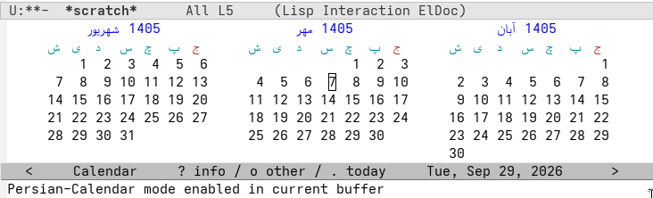

# persian-calendar.el

Persian (Jalali) display for Emacs's built-in `M-x calendar`.

Emacs ships `cal-persia.el`, but it only provides date *conversions* — the
visual calendar grid is hardcoded Gregorian. This package adds a toggleable
minor mode that renders the three-month window as three Persian months, with
Farsi month and day names, the week starting on Saturday, and Friday
highlighted as the weekend.



While the mode is active, only the *display* is Persian. Every date crossing
a function boundary remains Gregorian: `calendar-cursor-to-date` converts
the Persian cell under point back to its Gregorian equivalent. As a result,
diary marking, org-agenda integration, `calendar-goto-date`, sunrise/lunar
commands, and today highlighting all keep working with no knowledge of the
mode. All behavior changes are advice gated on the buffer-local mode flag,
so Emacs behaves exactly stock while the mode is off.

Navigation is Persian-aware: `{` / `}` move by Persian month, `[` / `]` by
Persian year, `M-a` / `M-e` go to Persian month boundaries, and scrolling
moves the window by Persian months.

## Accuracy

`cal-persia.el` implements Birashk's arithmetic 2820-year cycle, which
disagrees with Iran's official astronomical calendar during 1403–1404,
1436–1437, and 1469–1470 (Birashk misplaces the leap year at those cycle
boundaries — Nowruz 2025, 2058, and 2091 in Gregorian terms). By default
this package corrects that globally by overriding cal-persia's conversions
with the 33-year cycle algorithm (Toossi/Pournader, as used in jalaali-js),
which matches the official calendar exactly for the years 1178–1633 AP.
The correction applies to everything built on cal-persia — diary entries,
org helpers, `calendar-persian-date-string` — so all Persian dates in your
Emacs stay consistent with the grid. Set
`persian-calendar-official-calendar` to `nil` to keep Birashk's arithmetic.

## Requirements

- Emacs 31.1 or newer

## Installation

Not yet on MELPA. Manual installation:

```elisp
(use-package persian-calendar
  :ensure nil
  :load-path "/path/to/persian-calendar.el/"
  :after calendar
  :bind (:map calendar-mode-map ("P" . persian-calendar-mode)))
```

Then press `P` in `M-x calendar` to toggle the Persian grid, or enable it
for every new calendar window:

```elisp
(setq persian-calendar-auto-enable t)
```

## Customization

| Variable | Default | Description |
|---|---|---|
| `persian-calendar-auto-enable` | `nil` | Enable the mode in every new calendar window |
| `persian-calendar-official-calendar` | `t` | Use the official 33-year cycle calendar instead of Birashk |
| `persian-calendar-week-start-day` | `6` (Saturday) | First day of the week on the Persian grid |
| `persian-calendar-weekend-days` | `'(5)` (Friday) | Weekend days on the Persian grid |
| `persian-calendar-use-farsi-names` | `t` | Farsi names; set to `nil` for Latin transliterations |
| `persian-calendar-month-name-array` | فروردین … اسفند | Month names |
| `persian-calendar-day-header-array` | ی د س چ پ ج ش | Day column headers (Sunday-first) |
| `persian-calendar-month-header` | — | Sexp producing the month heading |

## Limitations

- Holidays are not supported while the mode is active (`a` and `x` signal
  an error).
- `calendar-show-more-months` / `calendar-show-fewer-months` are not
  supported in Persian mode.

## Development

Run the test suite:

```sh
emacs -Q -batch -L . -l persian-calendar.el \
  -l persian-calendar-tests.el -f ert-run-tests-batch-and-exit
```
